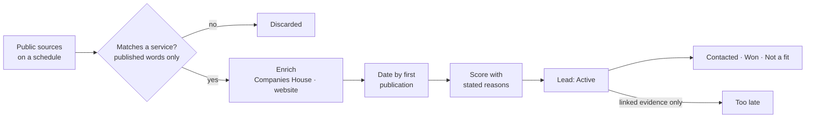

<p align="center">
  
</p>

<h1 align="center">SYRIX Lead Finder</h1>

<p align="center">
  <b>A local app that finds organisations and people with a current, evidenced need for a business-immigration and expansion consultancy — and retires a lead only when a source proves the need has passed.</b>
</p>

<p align="center">
  JavaScript · Node.js built-ins only · zero dependencies<br>
  <a href="https://kabirr-kohli.pages.dev/work">Project page</a> ·
  <a href="https://kabirr-kohli.pages.dev">Portfolio</a>
</p>

<br>

## Why it exists

Most lead tools sell a list of names. A name is not a lead: a lead is someone who needs something right now, and the proof of it. SYRIX Lead Finder only creates a lead when a public source has published words that show a current need — a tender, a register entry, a penalty notice, a post asking for help — keeps those words as the evidence, and dates the lead by when the source published it, not when the app happened to find it. It runs on the user's own computer; lead data never leaves it.

## Highlights

| Source | What it gives |
|---|---|
| Find a Tender, Contracts Finder | Public bodies inviting bids for relevant work, with the named buyer contact, deadline and value |
| Register of licensed sponsors | B-rated sponsors, overseas businesses on the UK Expansion Worker route, and sponsors newly added or removed |
| Illegal working penalties report | Employers named for illegal working penalties |
| Reddit, Immigration Boards | People asking how to do something the consultancy supports |
| Companies House, organisation websites | Company status, directors, registered office, and published email and phone — each with the page it came from |

Every lead shows why it is a lead (with the published words), which service fits, how to reach them and where each detail was found, a strength score with its reasons, notes, and a history of every status change. A built-in SYRIX assistant answers questions about the leads, Companies House, GOV.UK guidance and the wider web — read-only, it never changes anything.

## How a lead is made



## Engineering notes

- **Evidence, never inference.** A lead is attached to a service only when a rule matches text the source actually published, and the matching words are kept. Public tenders also carry a procurement (CPV) code chosen by the buyer, which counts as stronger evidence than wording — but a broad code alone is not trusted without the subject named in the text.
- **The date is the source's, not ours.** Register-based leads used to show "today" while the company behind them dated from 2022. Every lead is now dated by when the evidence was first published: a re-amended tender is traced back to its first release, a penalty to the period in the report's own title, an Expansion Worker sponsor to its company's incorporation date.
- **Too late needs proof.** A lead moves to Too late only with linked evidence — a closed or awarded tender, a restored A rating, a dissolved company, the person saying the need has passed — or when its evidence is older than its kind allows. A lead the user has contacted is never aged out.
- **Polite to every source.** Find a Tender rate-limits at about 1.5 s spacing, so requests are 4 s apart and partial sweeps are kept and resumed. Reddit's RSS is read with a 30 s gap. A search engine that answers bulk lookups with an "anomaly" page is detected and paused for six hours rather than hammered.
- **Namesakes don't merge.** Company-name keys keep words like *Group*, *Holdings*, *UK* and bracketed places, so two different companies with similar names never collapse into one lead, and a live company is preferred over a dissolved one.

## Dates and staleness

| Lead | Original date | Too late after |
|---|---|---|
| Post | When it was posted | 30 days |
| Tender | First publication, read from the procurement's history | The deadline; with no deadline, 90 days |
| Illegal working penalty | When the Home Office published the report | A year after the penalty period ends |
| New or removed sponsor | Between the two daily registers compared | 90 days |
| Expansion Worker sponsor | Bounded by the UK company's incorporation date | Two years, the route's maximum |
| B-rated sponsor | Current while it stays on the register | When the A rating is restored |

Nothing older than three months is shown in any tab, count, export or assistant answer. The rules live in `src/freshness.js`.

## Privacy and contact rules

- Lead data stays in `data/` on the user's computer and is never uploaded or committed.
- People are offered a reply on their own post and their public profile, never an email; leads about people are deleted 30 days after they are dismissed or too late.
- Organisations are contacted only through published business addresses, with the reason for contact stated. `docs/RESEARCH.md` sets out the rules and why each source was chosen.

## Tests

```
npm test                    # 56 offline tests: matching, sources, dating, enrichment, store, server, interface
node tests/live.js          # a live read of each source, no window
```

## Running it

Requires Node.js 20 or later — nothing to install; the app uses only Node's built-in modules.

```
node server.js              # opens http://127.0.0.1:7862
node server.js --no-open    # start without opening a browser
```

The assistant connects to a SYRIX gateway named by `SYRIX_GATEWAY_URL`, using this app's own device token.

## Repository layout

```
server.js   Local web server and scheduler
src/        Sources, matching, enrichment, dating, scoring and the lead store
src/syrix/  The read-only assistant: gateway client, tools, chat
web/        Interface
tests/      Offline tests and a live source check
tools/      Icon builder and desktop-shortcut installer
docs/       Research notes on lead tools, sources and contact rules
```

## Development history

Developed in a private repository — 20 commits, October 2026 — and published here as a curated snapshot. The working history stays private because it contains local configuration from development.

---

<p align="center"><sub>© 2026 Kabirr Kohli. All rights reserved. Published for viewing; no licence is granted to copy, modify or redistribute.</sub></p>
